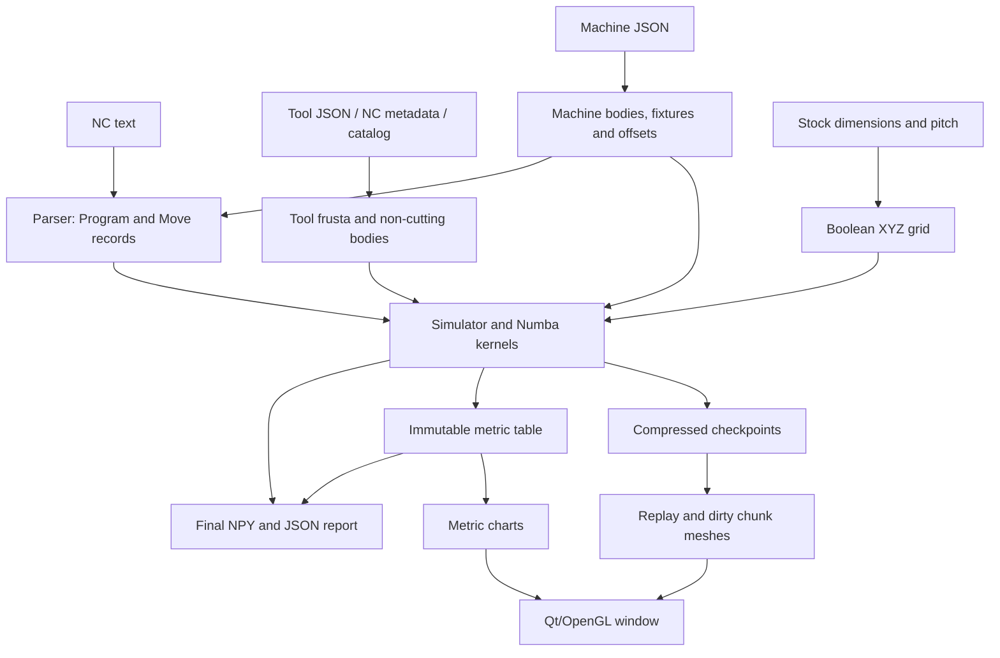

# cnc-sim — engineering handover

**Snapshot:** 12 November 2026 · **package:** `cnc-sim` 0.3.0 · **runtime:** standard, GIL-enabled, 64-bit CPython 3.14.

This document describes the delivered implementation, its design rationale, the evidence collected, and the work that remains. It is intended to let another agent continue without the original conversation. Source references and function names refer to the 0.3.0 repository/archive identified below. Decisions are implementation choices, not claims that the model reproduces every behavior of a real controller.

## 1. Start here

The simulator accepts three-axis NC and rectangular stock, removes material from a true 3D voxel array, checks configured collisions, saves final stock plus dynamic diagnostics, and opens an optional native Qt/OpenGL playback window. Python remains **standard x64 CPython 3.14**.

The metrics and rendering work was implemented in **0.2.0**: local Git with incremental commits; material removal rate (MRR, mm³/min); stock approach speed (positive normal component, mm/min) within 20 mm; both metrics in the result NPY and linked charts above the timeline; incremental full-resolution rendering; and this updated handover.

**98 tests passed** on Linux/Python 3.14.10. Native desktop playback measured **31.21 FPS** on an 800 × 600 × 120 grid (57.6 million 0.1 mm voxels) at 10× playback using Mesa llvmpipe software OpenGL. This excludes verification, initial meshing and arbitrary seeks. The reproducible headless raster benchmark, including metrics and collisions, took **2.92 s** for a nominal **1,941.80 s** job.

Native Windows execution and physical setup acceptance remain unfinished. The bundled default configuration is a nominal, unverified model of one machine; it is not universal geometry. The 124-tool catalog is not an exhaustive proprietary Makera Studio database export. Preserve these distinctions.

**Latest release, 0.3.0:** the distribution, repository, CLI and window are named `cnc-sim`; the import/module name is `cnc_sim`. Windows launchers, CI, benchmark scripts and package resources use the new namespace. Reinstall after upgrading and update external imports/commands; the previous package namespace and CLI are not shipped as aliases. NPY/JSON field schemas and numeric geometry are unchanged. Machine branding and original source references are confined to `cnc_sim/data/default_machine.json`. The generic example uses `examples/machine.template.json`; neither profile is verified. The 124-tool catalog is now `data/tool_catalog.json`; stable catalog IDs and numeric geometry are preserved, and renamed display names retain lookup aliases in the default configuration. G28 still requires explicit ordered waypoints; this release does not claim support for arbitrary controller homing semantics. Existing Git history is preserved. Machine configuration now accepts an optional `provenance` metadata block; other unknown fields remain errors. The full suite passed in 6.925 s (98 tests). The Python 3.14 wheel was built and installed separately, then its CLI/module entry points, resource loading, default/custom profiles and offscreen window/header labels were checked. The regenerated generic example retains exactly the same stock array and all 426 metric rows as 0.2.2. The wheel and current tracked source were scanned for residual machine branding outside the default configuration. See `validation/project_rename.json` and `validation/tests_project_rename.xml`; native OpenGL performance was not remeasured.

**Previous patch, 0.2.2:** standardized the chart titles and code/documentation terminology as **Material removal rate** (MRR, mm³/min) and **Stock approach speed** (mm/min). Chart tooltips explain interval averaging, the positive voxel-face-normal component, the 20 mm probe cutoff and start/mid/end peak sampling. `METRIC_LABELS` supplies the shared display names; the calculation is named `stock_approach_speed()`, with `normal_approach` retained as an alias for existing callers. NPY fields `removal_rate_mm3_min` and `approach_speed_mm_min`, JSON keys, units, row layout and numerical calculations remain compatible with 0.2.0/0.2.1. JSON definition strings use the new terminology. No performance benchmark was repeated for this naming-only patch. The full 97-test suite passed in 9.142 s (`validation/tests_metric_names.xml`); offscreen chart titles/tooltips and layout were checked, and the 0.2.0 example metrics still load without conversion.

**Previous patch, 0.2.1:** fixed the toolpath being overwritten by the stock. `GLLinePlotItem` uses additive blending with depth testing disabled; drawing it before stock meant later opaque stock painting erased it. The path now explicitly uses `glOptions="additive"` and `setDepthValue(100)`, so it draws after stock, fixtures and tool/head meshes even when they are replaced on seek or tool change. `depthValue` controls draw order, not geometric Z. The path is intentionally an inspection overlay, including segments inside or behind stock. No toolpath coordinate offset, stock transparency change, simulation/kernel or NPY schema change was made.

Native Linux/Python 3.14 verification reproduced the old rendering by temporarily switching the item's draw order, then checked the fix during playback, orbit and stop/rewind. The comparison control was temporary test code and is not shipped. The complete 97-test suite passed again in 15.056 s. The 31.21 FPS figure below is the **0.2.0 benchmark**, not a new 0.2.1, 0.2.2 or 0.3.0 measurement.

### Delivered source and repository

[Download cnc-sim.zip](https://chatgpt.com/library?file_id=libfile_fde3_f-ccf424dfa2388191b14add94ab57380c_e95ac02493bc8191a8d2024072df5f9a&account_id=personal)

| Property | Current value |
|---|---|
| Package / runtime | `0.3.0`; `>=3.14,<3.15` |
| Archive top-level folder | `cnc-sim/` |
| Git | Branch `main`; public remote `origin`: https://github.com/gnhdnb/cnc-sim.git; original incremental history preserved |
| Handover | `HANDOVER.md` in the repository; identical standalone `CNC_SIM_HANDOVER.md` |
| Validation | `VALIDATION.json`, supporting records under `validation/` |
| Example export | Regenerated with v2 report and appended metrics; voxel grid exactly matches the original reference |

Git history is the authoritative change record. Run `git status --short` and `git log --oneline` after extraction. No dependency environments, downloaded wheels, credentials or temporary research trees are included in the archive.

| Commit | Change boundary |
|---|---|
| `133f72e` | Imported delivered Python 3.14 baseline and previous handover |
| `1c474d5` | Dynamic metrics, sampling, compatible NPY stream and regression tests |
| `c44ac3d` | Incremental full-resolution chunk meshing and boundary oracle tests |
| `321d798` | Linked charts and incremental desktop playback |
| `84291a3` | Single-draw stock batching, layout fixes and native benchmark script |
| `d7fd374` | Version 0.2.0, final regression/evidence, refreshed example and documentation |
| `69786e7` | Version 0.2.1, final toolpath-overlay draw order, refreshed tests and handover |
| `3dd9874` | Version 0.2.2, metric terminology, chart tooltips and compatibility |
| `6918f37` | Version 0.3.0, project/package/UI rename, default config/provenance and catalog alias compatibility |
| Following commit | Version 0.3.0, generic example export, validation and handover; obtain hash with `git log` |

The import came from the previous 79,991-byte 0.1.1 ZIP, SHA-256 `045690f5fb56510ddcb94469d7e79831c3476b75853232d3955a545afd7a677f`. That checksum describes the **old import only**, not this ZIP. Do not put a self-referential current archive hash inside a document included in that archive.

### First actions for the next agent

1. Read this handover, `README.md`, `VALIDATION.json` and `git log`.
2. On native Windows, use standard x64 Python 3.14; run `setup_windows.cmd`, `demo_viewer.cmd`, and all tests.
3. Run `scripts/benchmark_playback.py --seconds 10 --speed 10 --output playback.json` on the user's actual GPU/driver. Measure frame rate and initial/seek latency separately.
4. Inspect new metrics on a real NC sample. Confirm the explicitly defined **voxel-face** normal and interval-peak approach behavior meet the intended diagnostics; do not silently replace it with total feed or distance to the original stock bounding box.
5. Obtain measured tool/stickout, fixtures, start position, offsets and exact G28/M6 firmware behavior before treating physical job verification as complete.
6. Continue in small Git commits; preserve parsing, collision chronology, NPY compatibility and export immutability.

## 2. User goal and scope

The original request was a Python voxel **three-axis CNC simulator** with:

- NC file and stock dimensions as inputs.
- A simulated final job result saved as a NumPy array.
- A nominal 100 µm resolution/accuracy target.
- Support for Makera Studio carving tool families.
- Spindle, holder and machining-head geometry for collision checking.
- A startup visualization flag opening a desktop window with timeline, speed, start/stop/seek and mouse orbit/pan/zoom.
- Enough speed for automated agent verification.
- Windows operation.

The user subsequently required **Python 3.14**, then requested this 0.2.0 iteration: create Git history, add the two dynamic metrics and charts, make full-resolution playback usable in real time, and update the handover. Their purpose is to spot plunges and fast approaches that can cause a hit when real motion is imperfect. Do not add guessed material-specific danger thresholds or claim that a geometric diagnostic models those imperfections. They prefer incremental implementation and verified numbers, with limitations stated plainly.

Relevant workshop context: the user's machine motivated the bundled default profile, and they use its community controller/firmware. They also do four-axis work, but the requested simulator is explicitly three-axis. Rotary axes are currently rejected. Do not infer that four-axis support exists because the user owns that accessory.

The intended use is geometric NC verification. The application has no connection to the machine and sends no control commands. It is not a controller emulator, cutting-force solver, crash-proof machine certificate, or material-specific feeds/speeds advisor.

### What “100 µm” currently means

The default **voxel pitch is 0.1 mm**. It does not guarantee physical machining accuracy within 100 µm. Occupancy and stock contacts use voxel centres. Arcs and curved cutter profiles are additionally approximated within configurable chord tolerances. Runout, deflection, backlash and controller dynamics are outside the model.

This was an explicit engineering interpretation of the resolution requirement. A future claim about a bounded total geometric error would require a separate error analysis and acceptance tests.

## 3. Decision register

| Decision | Implemented choice | Reason and consequence |
|---|---|---|
| Stock representation | Dense, C-contiguous, three-dimensional `numpy.bool_` array | Preserves roofs, cavities and undercuts from T-slot, dovetail and similar tools. One byte per voxel; large stock can consume substantial memory. |
| Cutting geometry | Union of coaxial/revolved frusta | One numeric representation handles cylindrical, tapered, rounded and non-monotone radial profiles. Uses the rotating envelope, not individual flutes. |
| Straight motion | Analytic continuous swept volumes | Avoids gaps from stamping tool positions at discrete intervals, including long or fast moves. |
| Curved motion | Arc/helical path split into bounded-error chords | Reuses the same continuous straight-sweep engine while retaining a stated path approximation. |
| Curved cutter profiles | Piecewise-linear radial profile with bounded chord error | Reuses frusta; rounded geometry is not analytically spherical in the cutting kernel. |
| Numeric runtime | Numba CPU kernels, float64 geometry, `cache=True`, `nogil=True`; no `fastmath` | Keeps a Python API and supports normal Windows wheels without requiring a C++ compiler or GPU. No GPU backend is implemented. |
| Collision ordering | Compare first body arrival against first active-cutter arrival before changing stock | A later cut cannot conceal an earlier holder/head crash on the same segment. |
| Fixtures | Fixed axis-aligned boxes, tested continuously | Detects even thin fixtures independently of voxel pitch. General mesh fixtures remain future work. |
| Machine geometry | Frusta/revolved profiles and axis-aligned boxes | Transparent, configurable envelopes with bounded complexity. No runtime STEP/STL collision importer. |
| Default machine | Nominal Air envelopes extracted from official simplified CAD, marked unverified | Better provenance than invented dimensions; still requires physical verification and accessory geometry. |
| Unknown NC behavior | Reject unsupported commands/syntax | An agent must not receive a successful result from a silently altered toolpath. The parser is intentionally a restricted dialect. |
| Work/machine coordinates | One explicit simulation frame; configured offsets | Avoids inventing machine home, WCS positions or tool-length tables. |
| G28 | Explicit ordered clearance waypoints | Controller-specific clearance positioning and homing are not inferred. |
| M6 | Tool state changes plus optionally supplied return waypoints | Hidden service/probe/ATC movement is excluded. Default return-position assumption is reported as incomplete. |
| Tool identification | Explicit NC T-number mapping, optional catalog lookup or supported NC metadata | Catalog IDs and job tool slots are different concepts. Names alone cannot prove installed geometry. |
| Verification status | Separate collision, incomplete-model and clear-in-model outcomes | Zero detected collisions must not silently imply verified geometry. |
| Result format | Two consecutive numeric NPY arrays in one file: bool XYZ grid, then structured metrics; adjacent schema-v2 JSON | Existing `np.load(path)` and memory maps still return the grid. Helpers read the appended metrics without loading the grid. No pickle/object payload. |
| File writes | Individually atomic NPY and JSON replacement, raw-array hash | Avoids partially written individual files; the pair is not a two-file transaction. |
| UI workflow | Compute and save final result first; then replay | Playback does not overwrite or corrupt the final exported result. |
| Seeking | Bounded compressed checkpoints plus replay | Deterministic backward seeking without storing a full grid for every frame. |
| Display geometry | Cached greedy surfaces for 64³ chunks; invalidate cutting bounds plus one-cell halo; pack surfaces into one GPU draw | Full resolution is default and never silently coarsens. Avoids whole-grid scans and per-chunk draw overhead during playback. Arbitrary seeks still rebuild. |
| Removal metric | Actual cleared voxel count × pitch³ × 60 / interval duration | Captures actual engagement and zero on noncutting moves; interval mean, not cutting force. |
| Approach metric | Largest inward velocity component toward a remaining-stock voxel face within 20 mm of the rotating cutter envelope | Six face normals, including undercut ceilings. Explicitly not a smooth-normal estimator; excludes fixtures/head from this diagnostic. |
| Sampling | At most 0.1 s and 1 mm per interval; start/mid/end approach probes before interval removal | Bounded diagnostic sampling cost and useful peaks; not a mathematically exact continuous peak bound. |
| Charts | Precomputed immutable metric history with synchronized seek cursors | Playback speed does not rescale physical metrics; peak-preserving display reduction does not modify saved samples. |
| Python migration | 0.1.1 targets 3.14 and uses `.venv314` in Windows launchers | Makes the requested runtime explicit and avoids reusing an old `.venv` interpreter. |
| Dependency policy | Bounded version ranges, tested versions recorded | Installation is convenient, but it is not fully locked/reproducible across future releases. |

## 4. Architecture and source map



| File | Responsibilities and primary entry points |
|---|---|
| `cnc_sim/cli.py` | `argument_parser()`, `prepare(args)`, `main(argv)`: input validation, metadata precedence, model construction, headless or GUI dispatch, exit codes and temporary memmap cleanup. |
| `cnc_sim/gcode.py` | `NCError`, `Move`, `Program`, `Parser`, `arc_points()`: strict modal parsing and expansion to timed straight segments. |
| `cnc_sim/tools.py` | `Tool`, `Body`, `make_tool()`, `make_body()`, `profile_frusta()`, `load_tools()`, `embedded_tools()`: cutter and assembly geometry. |
| `cnc_sim/catalog.py` | `catalog()`, `resolve_tool_spec()`: package-resource loading and explicit catalog lookup. |
| `cnc_sim/kernels.py` | Continuous sweep/removal/contact routines and numeric interval/quadratic helpers. |
| `cnc_sim/engine.py` | `Stock`, `Machine`, `Simulator`, `SimulationReport`, `SnapshotCache`, `save_result()`, `load_metrics()`, `load_result()`, `warmup()`: simulation, sampled metrics, collisions, checkpoints and two-array export. |
| `cnc_sim/replay.py` | `Replay.seek()`, `Replay.part()`: GUI-independent, fractional, bidirectional replay. |
| `cnc_sim/metrics.py` | `METRIC_DTYPE`, `sample_count()`, `stock_approach_speed()`, `has_stock_ahead()`, `metric_summary()`: sample schema and six-direction stock approach queries. |
| `cnc_sim/chunkmesh.py` | `ChunkMesher`, `mesh_chunk()`, `chunk_mesh_kernel()`, `cutting_bounds()`: dirty chunks, seam ownership, cached surfaces and single-draw packing. |
| `cnc_sim/charts.py` | `MetricsCharts`: two linked plots, cursor/time synchronization, click and drag seek signals. |
| `cnc_sim/mesh.py` | `stock_mesh()`, `greedy_mesh()`, `pooled()`, `frusta_mesh()`, `boxes_mesh()`: rendering geometry only. |
| `cnc_sim/viewer.py` | `Worker`, `Signals`, `SeekSlider`, `View`, `Window`, `launch()`: native desktop UI and asynchronous preparation/replay. |
| `cnc_sim/__init__.py` | Package `__version__`. Keep it aligned with `pyproject.toml`. |
| `cnc_sim/__main__.py` | Enables `python -m cnc_sim`. |
| `cnc_sim/data/tool_catalog.json` | 124 nominal cutters and original numeric source geometry. |
| `cnc_sim/data/default_machine.json` | Default unverified nominal assembly envelopes and CAD transform/provenance. |
| `examples/tools.json` | Synthetic/example flat, ball, V, drill and thread tool dimensions; all unverified. |
| `examples/machine.template.json` | Illustrative machine and G28 configuration, not factory data. |
| `examples/demo.nc` | Two-tool pocket/circular-feature demonstration. |
| `examples/collision.nc` | Deliberate rapid-through-stock program. |
| `examples/results/` | Current 0.2.0 sample NPY/report, with original voxel geometry preserved exactly and 426 appended metric rows. |
| `scripts/benchmark.py` | Reproducible synthetic raster benchmark with collisions and metrics enabled. |
| `scripts/benchmark_playback.py` | Native Qt/OpenGL benchmark: actual swaps, delivered frames, worker compute latency, GL renderer, display pitch and speed. Optional `--quit-after`; otherwise leaves window open for inspection. |
| `tests/` | Seven test modules; 98 test cases after parametrization. |
| `.github/workflows/tests.yml` | Windows/Linux Python 3.14 matrix; tests and viewer imports. Not run on GitHub in this session. |
| `setup_windows.cmd`, `demo_viewer.cmd` | Windows bootstrap and demonstration; CRLF line endings. |
| `README.md`, `HANDOVER.md`, `VALIDATION.json`, `validation/` | User manual, current engineering context, tests/performance and explicitly labeled historical evidence. |

There are 14 package Python modules. Qt is imported lazily from the CLI only when `--visualize` is requested. The headless engine does not require the viewer extra.

## 5. Runtime, installation and migration history

### Current dependency declarations and tested versions

| Component | Declared requirement | Tested in the Python 3.14 environment |
|---|---|---|
| CPython | `>=3.14,<3.15` | 3.14.10, standard GIL-enabled x64 Linux build |
| NumPy | `>=2.3.3,<2.4` | 2.3.5 |
| Numba | `>=0.63.1,<0.66` | 0.65.1 |
| llvmlite | Transitive Numba requirement | 0.47.0 |
| PySide6 Essentials | `>=6.10,<7`, viewer extra | 6.12.0 |
| Shiboken6 | Exact transitive requirement of PySide6 Essentials | 6.12.0 |
| PyQtGraph | `>=0.14,<0.15`, viewer extra | 0.14.0 |
| PyOpenGL | `>=3.1.7,<4`, viewer extra | 3.1.10 |
| pytest | `>=8.4,<10`, test extra | 9.2.0 |
| setuptools | `>=77.0.3`, isolated build dependency (raised for SPDX license metadata during GitHub publication) | Build succeeded; exact build-env version was not recorded |

`shiboken6` is Qt's Python/C++ bindings support library. It is pulled in automatically by `PySide6-Essentials`; version 6.12.0 of that package requires exactly `shiboken6==6.12.0`. The user asked what it was after installation; no special Shiboken configuration was needed.

Free-threaded Python builds were not tested or targeted. Do not describe a downloaded `cp314` wheel as proof of `cp314t` compatibility.

### Windows quick start

From the extracted project directory:

```powershell
.\setup_windows.cmd
.\demo_viewer.cmd
```

Equivalent manual setup:

```powershell
py -3.14 -m venv .venv314
.\.venv314\Scripts\python.exe -m pip install --upgrade pip
.\.venv314\Scripts\python.exe -m pip install ".[test,viewer]"
.\.venv314\Scripts\python.exe -m pytest -q
.\.venv314\Scripts\python.exe -m cnc_sim --version
```

For headless-only use, install `.` rather than `.[viewer]`. The installed console entry point is `cnc-sim`; `python -m cnc_sim` is often simpler when an agent must select an exact interpreter.

### Changes from 0.1.0 to 0.1.1

- Runtime requirement changed from `>=3.11,<3.14` to `>=3.14,<3.15`.
- Package version changed in both `pyproject.toml` and `cnc_sim/__init__.py`.
- NumPy, Numba, PySide6 and pytest minimums were raised.
- Windows scripts now call `py -3.14` and use `.venv314`.
- README commands and GitHub Actions matrix now target 3.14.
- Validation metadata was updated to distinguish current Python 3.14 tests from original Python 3.12 interactive tests and benchmarks.
- Numeric simulation algorithms were unchanged. The installed 3.14 package produced a demo ndarray exactly equal to the previous sample.

A 0.1.1 wheel was built and inspected for `Requires-Python` and packaged JSON resources. The deliverable is the source ZIP; downloaded dependency wheels and development virtual environments are not bundled.

## 6. Inputs, coordinate conventions and output contract

### CLI defaults worth preserving

| Option | Current default/behavior |
|---|---|
| Positional `nc` | UTF-8 NC file; UTF-8 BOM accepted |
| `--stock X Y Z` | Required positive dimensions, mm |
| `--stock-origin X Y Z` | Minimum stock corner; defaults to `(0,0,-stock_height)` |
| `--pitch` | `0.1` mm |
| `--start X Y Z` | Actual initial tool tip in simulation coordinates; if omitted, assumes `(0,0,5)` and marks result incomplete |
| `--initial-tool` | `1` |
| `--rapid-feed` | `2400` mm/min for nominal timing; not a validated machine maximum |
| `--arc-tolerance` | `pitch/20`; 0.005 mm at default pitch |
| `--profile-tolerance` | `pitch/20`; 0.005 mm at default pitch |
| `--collision-margin` | `0` mm; nonnegative envelope inflation |
| `--tools` | Optional JSON; explicit definitions override corresponding embedded NC tools |
| `--machine` | Optional JSON; otherwise loads nominal Air profile |
| `--output`, `-o` | `result.npy`; suffix must be `.npy` |
| `--memmap` | Off; when enabled, temporary disk-backed working grid |
| `--max-voxels` | 2,000,000,000; allocation guard for one-byte bool voxels |
| `--block-delete` | Off; `/` blocks execute unless flag is supplied |
| `--json` | Final JSON to stdout; progress to stderr; incompatible with `--visualize` |
| `--quiet` | Suppresses progress; use `--json --quiet` for agents |
| `--metrics-period` | `0.1` s maximum diagnostic interval duration |
| `--metrics-distance` | `1.0` mm maximum diagnostic interval travel |
| `--max-metric-samples` | `2,000,000`; rejects excessive table allocation |
| `--visualize` | Opens optional native viewer with charts; full-resolution display by default |
| `--list-tools` | Prints bundled catalog and exits without requiring a job |

CLI arc/profile tolerances must be positive and at most half the voxel pitch. The lower-level API does not reproduce every CLI guard automatically.

### Coordinates

All geometry is in millimetres in one simulation/world frame. With the default stock origin, stock spans `X=0..width`, `Y=0..depth`, `Z=-height..0`. The tool tip is the commanded point; the tool extends in positive Z. There is no tool tilt or workpiece rotation.

For voxel index `(i,j,k)`:

```python
center_mm = origin_min_mm + (index + 0.5) * pitch_mm
```

The array is indexed **XYZ**, not the ZYX convention used by many image-processing tools. It is C-contiguous, so Z is the fastest-changing index in memory.

`Stock.shape` uses `ceil(dimension/pitch - 1e-10)` to avoid floating-point near-integer over-allocation. Boundary occupancy is still centre-based: an allocated final cell can initially be air if its centre lies beyond the exact stock dimension. Do not infer material volume solely from `array.size` for non-integral stock dimensions.

Work offsets map G54–G59 origins into this frame. G54 initially exists at `(0,0,0)` unless configured otherwise. `machine_origin` is the location of machine-coordinate zero in the simulation frame. It is required for G53 and supported G10 offset updates.

### Files and report status

The first NPY record in `result.npy` contains `numpy.bool_`: **True = material remains**, **False = air**. The second record is a one-dimensional structured numeric metrics table. `result.report.json` supplies shape, pitch, origin, original stock dimensions, both raw-array hashes, model configuration, warnings, timings, collisions, incomplete reasons and metric semantics. The overall report schema is **2**; the nested metric schema is **1**.

| Exit code | Status/meaning |
|---|---|
| 0 | `clear_in_model`: no collision found and required model assertions are complete |
| 1 | `error`: parsing, unsupported commands, configuration, allocation or runtime error |
| 2 | `collisions`: collision or configured travel/RPM violation |
| 3 | `incomplete`: computation finished but model/setup assertions are missing |
| 130 | Headless keyboard cancellation |

Collision status takes precedence over incomplete status. Always inspect `verification_complete` and `incomplete_reasons` even after exit 2. Exit 0 is only a statement about this model's scope; excluded service motions and physical effects remain excluded.

The GUI returns the final report's exit code after closing. Closing before preparation succeeds leaves the worker's default error code 1; the README's cancellation code 130 describes the headless KeyboardInterrupt path, not every GUI cancellation.

A failed new run can leave an older completed output at the requested path. Agents must check the current process exit code, the report's NC SHA-256 and the array hash instead of consuming a pre-existing file blindly. Prefer separate output paths per job/run when integrating into automation.

`save_result()` writes the bool grid in 8 MiB chunks to a temporary NPY, closes its memory map, appends the second numeric NPY record with `np.save(..., allow_pickle=False)`, then replaces the destination. JSON is written/replaced separately. The pair is not transactional. `array.raw_array_sha256` hashes only C-order bool bytes; `metrics.raw_array_sha256` hashes only packed structured-row bytes. Neither includes NPY headers. `metrics.npy_header_offset_bytes` points to the second header; `npy_array_index` is 1. `input.nc_sha256` hashes the original NC bytes, including any BOM.

`Simulator.run()` returns `SimulationReport`, a JSON-serializable dict subclass with a `.metrics` ndarray attribute. `save_result()` uses that attribute automatically. Converting the report to a plain `dict` loses the attached array; pass `metrics=sim.metrics` explicitly then. A nonempty metrics summary with missing data raises instead of silently dropping the samples. Directly supplied arrays must have exactly `METRIC_DTYPE` and one dimension.

`load_metrics(path)` reads the first header and seeks over the bool payload without loading it. It returns an empty typed table for a legacy stock-only file and rejects malformed stock headers/truncated payloads or unexpected metric dtype. `load_result(path, mmap_mode='r')` returns `(stock, metrics)`. Both are numeric; never enable pickle. Third-party readers that require EOF immediately after a single NPY record may need adapting; NumPy's normal first-array and sequential-stream readers are supported.

### Dynamic metric definition and sampling

`METRIC_DTYPE` is packed, 57 bytes per row:

| Field | Dtype | Meaning |
|---|---|---|
| `t_start_s`, `t_end_s` | `<f8` each | Nominal interval start/end, seconds |
| `line`, `tool` | `<i8` each | Source NC line and T number |
| `removed_mm3` | `<f8` | Actually cleared voxel count × pitch³ |
| `removal_rate_mm3_min` | `<f8` | Material removal rate (MRR): `removed_mm3 * 60 / duration_s` |
| `approach_speed_mm_min` | `<f8` | Stock approach speed: maximum sampled positive stock-normal component |
| `rapid` | `?` | G0 flag |

For each parsed `Move`, `sample_count()` takes the maximum of 1, ceiling(duration / period), and ceiling(length / distance), with a small floating-point ceiling guard. All intervals remain continuous analytic sweeps, not point stamps. Default bounds are 0.1 s and 1 mm; each move keeps its source line, tool, spindle state and exact nominal timing. `Simulator.run()` preallocates the table and checks the sample-count cap before allocating it. Two million rows use 114,000,000 bytes (~108.72 MiB), separately from stock and mesh/checkpoint storage.

For an interval, velocity is the source segment delta × 60 / source duration. `stock_approach_speed()` tests moving axes in descending absolute velocity order, stopping at the first with stock ahead. It sweeps the actual cutting frusta along that signed face-normal direction by 20 mm, with half a voxel of axial allowance to account for the front voxel face. Other coordinates remain unchanged. The transverse cutter projection is centre-sampled, matching the solid representation. The metric is the corresponding positive component magnitude; if no moving axis has stock ahead within the range, it is zero.

The interval value is the maximum of probes at start, midpoint and end against **remaining stock before that interval is cut**. Then `Simulator.apply(part)` checks collisions and removes material, returning the newly cleared voxel count. This order sees an impending approach before the interval removes the target material. Collision duplicate suppression remains in the existing engine. Checkpoints are still indexed by original parsed moves, not metric subintervals.

Examples: a flat-stock diagonal velocity `(300, 0, -100)` above its top gives 100 mm/min if the top is in range. Pure horizontal travel above the top gives zero. Moving upward into an undercut roof can be positive. A deep pocket floor is measured at its actual remaining level, not original Z=0. Tangential/retreating motion is zero when no other stock is encountered in the query direction.

Limitations that must remain explicit:

- These are **axis-aligned voxel-face normals**, not fitted normals on a curved/sloping surface. Staircase effects can change which component is selected.
- Only the rotating cutter envelope and remaining stock are used. Fixtures, shank, holder and head use separate collision checks; this is not their proximity rate.
- An interval crossing the 20 mm boundary can have a nonzero peak although its start is farther than 20 mm away. At each probe the range test applies; the stored interval peak is not a continuously gated function.
- Start/mid/end probes do not prove the exact continuous peak; decrease period/travel for small transients. Removal rate is an interval **mean** with voxel quantization, not instantaneous chip engagement.
- A zero-duration interval that removes initial overlapping material retains volume but gets `NaN` rate; summary counts undefined samples. Motion with zero duration has no inferred finite approach velocity. JSON itself remains finite/strict.
- Nominal segment velocity is used. Acceleration, backlash, vibration, force, material, finite-flute engagement and spindle ramp are not inferred. No automatic danger threshold was chosen.

Read the two metrics separately:

```python
from cnc_sim.engine import load_result
stock, metrics = load_result('result.npy')
material_removal_rate = metrics['removal_rate_mm3_min']
stock_approach_speed = metrics['approach_speed_mm_min']
interval_start = metrics['t_start_s']
```

With NumPy alone, open the file once and call `np.load(stream, allow_pickle=False)` twice. A separate `.npz`, object dictionary or extra sidecar `.metrics.npy` is **not** the current storage contract.


## 7. Tool model and catalog

### Core types

`Tool` holds `number`, `name`, `kind`, `cutting`, `bodies`, `stickout`, `verified`, and the resolved input `spec`. `Body` holds a name, role, frusta and/or boxes.

A frustum row is float64 with this exact order:

```text
[x_offset, y_offset, z_bottom, z_top, radius_bottom, radius_top]
```

A box row is:

```text
[x_min, y_min, z_min, x_max, y_max, z_max]
```

Tool-local Z heights are measured upward from the programmed tip. `profile_frusta()` accepts ordered `[height, radius]` points. Repeated heights create radial steps and are skipped as zero-height segments; remaining positive-volume segments form a union. Profiles may increase or decrease in radius, so undercutting tools are supported.

`stickout` means tip-to-lowest-holder-face distance. A body anchored to `gauge` gets a Z translation equal to stickout; a `tip` body does not. `make_body()` also supports an XYZ `offset`.

### Families and parameters

| Family | Shape/required extra geometry |
|---|---|
| Flat, corn, O-flute, face | Cylindrical cutting envelope |
| Ball / ball nose | Hemispherical tip plus cylindrical flutes |
| Bull / corner radius | `corner_radius`; circular corner profile plus flat centre |
| V / engraving / chamfer / UV solder-mask | Explicit included `angle`, optional `tip_diameter` |
| Drill | Explicit included `angle`; conical point plus cylinder |
| Tapered flat | Included `angle`, optional `tip_diameter`, bounded by diameter/flute length |
| Tapered ball | `tip_radius`, `half_angle`; sphere-to-taper tangency |
| Thread mill | `neck_diameter`; optional `thread_angle`, `tooth_height`, `teeth`, `pitch`, `tooth_start` |
| Dovetail | Diameter at bottom narrowing to `neck_diameter` at flute top |
| T-slot / keyhole / slot | Cutting head cylinder plus separately non-cutting neck |
| Lollipop | Spherical envelope; `flute_length == diameter`; explicit neck geometry advised |
| Custom/profile, form, radius, corner-round, circle-segment families | Explicit radial profile; no guessed substitution for missing shape information |

`angle` is an included angle; `half_angle` is a half angle. Diameter and radius fields are distinct. Every tool needs `type` and `flute_length`; conventional tools also need `diameter`. `profile` and `tapered_ball` use their explicit profile/tip parameters.

Default shank diameter is 3.175 mm, default shoulder length is flute length, and default stickout is `max(flute_length + 10, 25.5)` mm. These defaults permit exploratory simulation; they are not measured data. A tool is considered verified only if the JSON `verified` value is an actual boolean true and explicit stickout plus shank diameter or `noncut_profile` are present.

The default neck fills the flute-to-shoulder gap and the shank runs from shoulder to stickout. `noncut_profile` replaces that default model. Optional per-tool `bodies` add collars or other geometry. Left-handed tools use `handedness: "left"`; otherwise clockwise M3 is treated as the cutting direction.

Unknown tool fields and unknown type names raise errors. The `verified` flag is an assertion supplied by the caller; it does not independently measure the tool or guarantee that every supplied profile is physically correct.

### T-number mapping and precedence

Tool JSON can be either a direct object keyed by NC T numbers or `{"tools": {...}}`. A catalog entry can be selected by exact `catalog_id` or a unique exact name, then overridden with measured geometry. Explicit JSON definitions override `;@MKR|TOOL|...` records for the same T number.

The supported metadata reader uses fields such as `number`, `type`, `diameter`, `flutelength`, `handlediameter`, `shoulderlength`, `sticklength`, `angle`/`halfAngle`, `tipdiameter` and `cornerradius`. It marks imported tools unverified and warns. Incomplete thread, tapered-ball, custom-profile and dovetail metadata requires a separate JSON definition. No direct Studio SQLite/database importer is shipped.

### Bundled catalog provenance and limits

124 cutters were extracted from the official Makera Fusion tool-profile files at commit:

`de08a657bdc9c230a094dbdba792acd70bfcdf32`

| Normalized family | Entries |
|---|---:|
| Flat/O-flute/corn | 45 |
| Drill | 30 |
| V/engraving/chamfer | 23 |
| Ball | 18 |
| Thread | 8 |
| **Total** | **124** |

Entries retain `source_file`, original numeric `source_geometry`, original `source_holder` information where present, a resolved `spec`, and a stable source ID. Nominal stickout uses Fusion body length `LB`; this must not be assumed equal to the user's installed extension. Recorded source-holder metadata is provenance and is not automatically substituted for the configured machine holder.

Thread entries use revolved triangular tooth envelopes. Actual tooth location, truncation, pitch, neck and mounting geometry need confirmation. Catalog entries are all unverified by default. Lasers and holder-only definitions were not counted as carving tools.

**Do not claim every tool in every release of Makera Studio is automatically supported.** The engine covers many radial families, and custom profiles cover further axisymmetric forms. The proprietary database, its current schema and every shipped physical tool have not been exhaustively validated.

## 8. Machine model and collision frame

The default is `cnc_sim/data/default_machine.json`, derived from the Z component of the simplified CAD identified by its `source` and `source_commit` fields. Machine branding, original source URLs and controller-specific notes are kept in that configuration. It is `verified: false` and `tool_change_restores_tip: false`.

The extraction recorded local spindle centre `x = -74.0385852576533`, `z ≈ 29`, and the lower nose face at `y = 201.458967162417` in the CAD component frame. The transformation is:

```text
simulation X = CAD x + 74.0385852576533
simulation Y = 29 - CAD z
simulation Z = CAD y - 201.458967162417
```

The gauge origin is the lower nose face. These are CAD derivation coordinates, not machine homing/WCS offsets.

### Default gauge-anchored envelopes, mm

| Body | Representation |
|---|---|
| `holder_nose` / holder role | Cylinder, radius 8, Z 0..20 |
| `spindle_nose` / spindle role | Cylinder, radius 16.7899370932549, Z 20..25 |
| `spindle_motor_envelope` / spindle role | Box min `[-31.001,-44,25]`, max `[30.650,29,196.210]` |
| `head_plate_envelope` / head role | Box min `[-60,29,26.779]`, max `[59.6,41,199.280]` |

The cylinders use extracted CAD radii; the boxes conservatively enclose their corresponding CAD bodies. The source is simplified CAD, not metrology-grade measurement.

The default omits X gantry, machine frame/enclosure, probe, dust shoe, hoses, wiring and installation-specific accessories. It also has no fixtures, travel limits, RPM ceiling, machine origin or G28 clearance path. Those absent constraints are not automatically inferred, and not all omissions are represented as an incomplete reason. A caller who sets `verified: true` must understand the restricted scope.

The separate machine template is illustrative and contains a sample `[{"z":20},{"x":0,"y":0}]` G28 path. Do not copy these coordinates into a real verification setup without establishing them.

### Supported configuration

- Moving `bodies`: `cylinder`, `frustum`, `profile`, or axis-aligned `box`, with name, role, anchor and optional offset.
- Fixed `fixtures`: named axis-aligned boxes in the simulation frame; fixtures are never cut away.
- `work_offsets`: configured G54–G59 origins.
- `machine_origin`: machine-coordinate zero in the simulation frame.
- `clearance_moves`: ordered partial lower-case `x`, `y`, `z` world-frame waypoints for standalone G28.
- `tool_change_moves`: optional explicit post-M6 return waypoints in the same frame.
- `tool_change_restores_tip`: caller assertion of return to the prior programmed tip when no explicit return path is supplied.
- `travel_limits`: min/max box, with `limits_reference` equal to `tip` or `gauge`.
- `max_rpm`: optional positive spindle speed ceiling.

The completeness check requires machine body roles `holder`, `spindle` and `head` in the machine configuration, plus machine verification. Per-tool bodies alone do not satisfy this machine-role check. Unknown machine/body/fixture fields and string values masquerading as verification booleans are rejected.

All moving bodies currently translate with the tool tip. There is no general machine-kinematic hierarchy. Do not attach a real axis-dependent gantry part as if it followed XYZ identically unless that is a deliberately conservative envelope.

## 9. Parser behavior and firmware boundaries

`Parser.parse()` creates a fresh local modal state on every call. Configured offsets are copied; G10/G92 changes from one parse do not leak into the next parse. `Move` contains start/end arrays, tool number, spindle direction, RPM, rapid flag, source line, start/end time and kind. `Program` holds moves, warnings and events; duration is the final move's end time.

Initial state is mm, G90, incremental arc centres, G17, G54, G0, G94, spindle off, zero RPM, undefined feed and the configured initial tool. The parser's default initial tip is `(0,0,5)`; the CLI tracks whether this was explicitly supplied.

| Commands | Current interpretation |
|---|---|
| G0/G1 | Straight rapid/feed movement; feed movement requires positive F. |
| G2/G3 | G17/G18/G19 arcs and helices; IJK centres or positive/negative R; IJK full circles. |
| G90/G91 | Absolute/incremental endpoints. |
| G90.1/G91.1 | Absolute/incremental arc centres; absolute centres need both in-plane coordinates. |
| G20/G21 | Inch-to-mm conversion / mm; G20 emits a community-firmware caveat. |
| G54–G59 | Configured work offsets; undefined selection is an error. |
| G53 | G90 G0/G1 movement with configured `machine_origin`. |
| G10 L2 P1..6 | Work-offset update using machine origin; a new offset requires XYZ unless already configured. |
| G92 / .1 / .2 / .3 | Temporary offset set, clear, suspend and restore. |
| G28 | Standalone configured waypoint sequence; requires explicit ordered clearance waypoints. |
| G93/G94 | Inverse-time / units-per-minute feed. G93 requires F on every feed block. |
| G81/G82/G83 | Expanded drilling cycles in G17/G94; R/Z, dwell, pecks and repeats. |
| G98/G99, G80 | Initial-plane/R-plane cycle retract; cycle cancellation. |
| G4 P or S | Dwell in seconds. `G4 S` does not overwrite spindle RPM. |
| T, M6 | T preselects; standalone Tn M6 changes tool and stops spindle. |
| M3/M4/M5, S | Spindle direction/off and RPM state. |
| M0/M1 | Pause events; user waiting time is not assigned a duration. |
| M2/M30 | End event; later blocks are ignored. |
| M7/M8/M9, M400 | Accepted non-geometric coolant/synchronization commands. |
| G40 | Cutter-compensation cancellation accepted; G41/G42 unavailable. |
| G49 | Marks tip compensation unknown; motion/dwell is rejected until a subsequent M6 establishes tool state. |
| G61/G64 | Nominal programmed path; no corner blending. G64 warns. |

Community-style `G0 ... F...` is block-local when supplied with rapid axis motion; it does not overwrite the later cutting feed. Standalone F sets the modal feed. Default rapid timing is configurable. Speeds affect nominal timing, not the geometric envelope.

Arcs use right-handed plane mappings: G17 `(X,Y,Z)`, G18 `(Z,X,Y)`, G19 `(Y,Z,X)`. Inconsistent endpoint radii beyond `max(1e-7, arc_tolerance)` are rejected. Tiny accepted rounding discrepancies are interpolated rather than creating a final jump. Each arc is guarded against generating more than two million segments.

G83 re-entry toward the previous depth is deliberately emitted at feed, rather than guessing a controller-specific rapid clearance. Cycle repeat and peck counts are guarded. Cycle parsing capability does not imply every target controller firmware accepts those cycles.

Nested parenthesized comments, semicolon comments, blank lines, `%`, line numbers and bare O program labels are handled. `/` block deletion follows the CLI flag.

### Explicitly unsupported

Rotary/auxiliary `A B C U V W`, cutter compensation G41/G42, numeric tool-length compensation G43/H tables, probing, homing G28.2, height-map compensation, macros/variables, loops and subprogram calls, and unknown G/M commands are rejected. Duplicate words, conflicting supported modal commands, malformed syntax and unconsumed geometric parameters are also rejected in the implemented paths.

This is not a complete formal parser for all RS-274 dialects or controller firmware combinations. If a real export fails, establish the exact meaning and add a regression before implementing it. Do not solve compatibility by adding an unconditional “ignore unknown command” mode to verification.

### M6 limitation

M6 sets the newly selected tool and stops spindle/RPM. Explicit `tool_change_moves`, when supplied, model only the configured return movements using the new tool. With no such path the parser warns that service motion is excluded and assumes the same programmed tip position. Unless `tool_change_restores_tip` is confirmed, this becomes an incomplete reason.

Neither branch models the entire ATC/manual-change/probe/calibration sequence. Adding return waypoints does not make hidden service motion verified.

## 10. Numeric geometry and collision chronology

### Material removal

Each convex frustum swept along a straight path intersects a fixed vertical XY column in one Z interval. `frustum_span()` computes that interval from endpoints, radius-transition points and stationary candidates. `remove_sweep()` enumerates candidate XY columns, converts the span to centre-based Z indices and clears those cells.

The algorithm still stores a complete 3D solid. Using column intervals accelerates the subtraction; it does not turn the stock into a height map. A non-convex tool is represented by multiple frusta whose individual contributions form a union.

Long diagonal moves use projected narrow XY bounds per X column rather than scanning their full rectangular XY bounding box. This avoids excessive work without subdividing the motion into arbitrary time steps.

### Contact primitives

- `quadratic_hit()`: earliest solution of a quadratic inequality in a bounded interval, using stable roots.
- `slab()`: linear interval clipping.
- `first_frustum_hit()`: first time a moving frustum reaches a given point.
- `first_box_hit()`: first time a translated box reaches a point.
- `collide_frusta()` / `collide_boxes()`: remaining-stock voxel contacts.
- `frustum_fixture_hit()` / `box_fixture_hit()`: continuous contacts against a fixed box; independent of stock voxel pitch.

`MISS` is 2.0, outside the segment fraction range `[0,1]`; the shared geometric epsilon is `1e-10`, with additional local near-degenerate guards. Fixture logic includes explicit endpoint/tangent checks because contact can occur at an isolated time without an open interval of overlap.

### Per-segment sequence in `Simulator.apply()`

1. Resolve the current tool and whether cutting is active: **not rapid**, positive RPM, and spindle direction matching handedness.
2. On the first segment or a change to a different tool number, check cutter overlap at the segment start before allowing material removal.
3. If cutting is inactive, test the cutter against stock with reason `rapid_into_stock`, `spindle_off`, or `wrong_spindle_direction`.
4. Test active cutters against fixtures; fixtures are never machinable stock.
5. Test every non-cutting tool/machine body against remaining stock and fixtures.
6. Apply configured travel and spindle-RPM limits.
7. Only then remove the swept cutting volume, if cutting is active.

For a stock voxel, a body collision is suppressed only if an active cutter arrives no later than the body, within numerical tolerance. A body arriving first remains a collision even if the cutter would remove that voxel later in the same segment.

A dwell with a running cutter can remove the stationary rotating envelope. The first-tool overlap check still prevents an initial embedded tool from being silently treated as a legitimate plunge.

Travel bounds are checked at segment endpoints. For a linear path through an axis-aligned allowed box this detects an out-of-bounds segment, but the report time is an endpoint sample, not an exact first boundary-crossing time. Arc behavior is based on its chords. RPM checks compare recorded S to an optional limit; there is no spindle acceleration model.

### Collision records

Records contain source line, tool, body, target, reason, nominal time, segment fraction, tip position and an optional contacted stock voxel centre. Fixture events have no stock contact voxel. Records are aggregated by `(line, body, target, reason)`, with earliest time retained and `occurrences` incremented. The count is a count of aggregated records, not a count of all contacted voxels or damaged parts.

After a detected collision, the engine continues subtracting along the hypothetical rigid programmed path. This is useful for diagnosis, but later geometry does not describe what a physically crashed machine would actually do.

### Collision margin

`expanded_body()` inflates collision frusta/boxes. The actual cutting-removal geometry remains uninflated. A positive margin can help inspect small clearances and intentionally produces conservative false positives; it is not a complete error bound covering all omitted physics.

## 11. Replay, rendering and UI concurrency

The GUI uses PySide6 Essentials + PyQtGraph OpenGL + PyOpenGL. A custom stock shader uses ambient and two directional contributions so pocket walls remain legible. The UI is a visualization client around the same simulation engine, not a separate numerical implementation.

`Worker` is one dedicated Python thread. It warms JIT kernels, computes the full report with checkpoints, saves final output, and emits a ready signal. Then it processes replay/mesh requests. This single-worker ownership avoids concurrent mutation of the stock grid.

Requests use a condition variable and one pending slot: a newer request replaces a pending older request. Seeking increments a generation number; stale frames are ignored by the UI. An in-progress sweep or mesh build is not instantly preempted. Cancellation is checked between simulation moves and during replay; closing joins the worker and can wait for an expensive current kernel/mesh operation.

### Checkpoints and replay

`SnapshotCache` targets about 24 checkpoints and a default 128 MiB compressed budget. It uses `np.packbits(..., bitorder="little")` followed by zlib level 1. Old frames are evicted when the budget is exceeded. If no earlier checkpoint remains, replay initializes the original stock and starts from the beginning. Restoration unpacks in chunks.

`Replay.seek()` uses move end times, restores an earlier checkpoint for backward seeking, and applies only the missing complete or fractional straight sweeps. Replay calls `Simulator.apply(check=False)`: it is visual stock reconstruction, not a new verification pass.

**Important API caveat:** replay mutates the simulator's working grid and some counters. The saved report/array remain the authoritative final result. Do not call `Simulator.report()` after arbitrary replay and treat it as a fresh final verification report. Likewise, a user-supplied `grid` to `Simulator` supplies storage; construction/reset initializes stock and does not load a previous machining result as initial material.

### Full-resolution chunk surfaces and batching

The old whole-grid `stock_mesh()` path scanned the entire bool array every frame. On 800 × 600 × 120 voxels, a simple pocket took a median **896.49 ms** per mesh despite only 28 triangles. That explains the user's approximately 1 FPS observation: voxel scanning dominated even when visible geometry was small.

Full-resolution mode now uses `ChunkMesher` with **64-voxel chunk edges**. `Replay.seek()` returns cutting bounds only when `Simulator.apply(check=False)` actually removed voxels, plus a `reset_stock` flag for a restored state. Bounds include the entire swept cutter envelope. Dirty marking expands by one voxel to invalidate newly exposed neighbouring chunk faces. Rapids, air cuts and stationary visual updates need no stock remesh when no material changes.

Each chunk reads neighbouring occupancy across its border. A face belongs to the chunk containing the occupied cell; artificial internal walls and duplicate boundary faces are not emitted. `tests/test_chunkmesh.py` compares the complete exposed face set with an independent voxel-neighbour oracle on randomized 3D solids, chunk-border edits, reset and combined-mesh packing.

`mesh_chunk()` starts with a 1,024-quad buffer and doubles capacity on overflow. It returns compact owned buffers and **does not downsample**. Cached arrays use float32 vertices and uint32 triangle indices. `ChunkMesher.combined()` packs cached surface arrays with adjusted triangle offsets; it never rescans voxels. Worker emits one stock mesh update, producing one stock `GLMeshItem`/GPU draw. This extra batching raised the native benchmark from about 22 FPS with separate chunk items to approximately 31 FPS. Merely reducing mesh CPU time did not suffice.

A representative one-chunk edit measured **3.36 ms** median / **3.62 ms** p95 for meshing alone. This is not the end-to-end desktop frame rate: a frame can dirty several chunks and includes replay, packing, Qt, chart updates, normal calculation and GPU upload/render.

Worker resets all chunks when replay restored stock, seek generation changed, or display stride changed. Generation reset is necessary because the GUI can discard an in-flight stale frame while the worker cache has already advanced. Arbitrary seeks and initial meshing are still roughly one-second operations for this benchmark. The UI remains on its own thread, but closing can wait for a current kernel or chunk; cancellation is checked between chunks.

Optional 2×/4× previews retain the old max-pooled whole-grid mesher and its 400,000-quad fallback behavior. Those explicitly coarse modes can hide small cavities. **Full resolution defaults to stride 1 and never invokes that fallback.** Display path decimation is independent of actual simulated moves. No GPU simulation backend or loss of full XYZ stock resolution was introduced. The path overlay is drawn after all mesh items with an explicit higher draw-order value; it is intentionally visible through stock for inspection, and no global depth-buffer settings are changed.

### Charts and controls

`MetricsCharts` is a PyQtGraph `GraphicsLayoutWidget` with two linked time axes above the timeline. Values come from the precomputed immutable table, not mutable replay counters. The displayed curve is a step per interval; automatic peak-preserving point reduction and clipping reduce screen drawing only. Left axes display explicit mm³/min and mm/min without SI prefix substitution. Shared cursors show displayed time. Clicking a plot or dragging a cursor pauses and seeks; the exact-time spinbox and collision list still work.

- Start, Pause and Stop; Stop rewinds to zero after preparation.
- Speeds: 0.1, 0.25, 0.5, 1, 2, 5, 10, 25, 50, 100 and 250×; default 10×. Speed changes playback time, not metric units/values.
- Click/drag timeline, chart seeking, exact-time spinbox, collision-click seeking.
- Left drag orbit; right/middle drag or Shift+left drag pan; wheel zoom.
- Space play/pause, Home stop/rewind, Ctrl+Q close.
- Full-resolution/2×/4× detail, head and path visibility, reset camera.
- Scrollable verification details prevent longer incomplete-reason lists from being clipped.

A 33 ms timer requests nominally 30 FPS. `View` measures actual `frameSwapped` events over recent frames, clearing its history after a pause gap. The status includes measured FPS and worker compute milliseconds. This is a useful observation, not a guarantee for every cutter, stock complexity, speed or driver.

## 12. Accuracy, memory and performance limits

At pitch `p`, a voxel centre is at most `sqrt(3)*p/2` from a corner. At `p=0.1 mm`, that distance is **0.08660254 mm**. Stock-face placement is quantized by centre occupancy, and sub-voxel features or clearances can be unresolved. The 0.005 mm default path/profile chord tolerances are separate approximations; do not simply call the whole simulator “100 µm accurate.”

Straight sweeps are analytic for the primitive model subject to floating-point tolerance. Rounded profile chords lie inside the corresponding ideal circular profile. Arc/tool approximation, actual tool dimensions and machine geometry must all be considered when assessing a narrow clearance.

The model excludes finite-flute engagement, spindle acceleration, runout, tool/workpiece deflection, backlash, acceleration/deceleration, corner blending, cutting forces, chip evacuation and fixture compliance. It also excludes tool breakage and physical consequences after a collision.

### Memory

A bool grid uses approximately `ceil(X/p) * ceil(Y/p) * ceil(Z/p)` bytes. Additional arrays, mesh buffers, Python move objects and checkpoint packing buffers consume memory beyond that number.

| Stock and pitch | Grid shape | Bool-grid bytes |
|---|---|---:|
| 30 × 20 × 6 mm, 0.1 mm | 300 × 200 × 60 | 3,600,000 |
| 80 × 60 × 12 mm, 0.1 mm | 800 × 600 × 120 | 57,600,000 |
| 100 × 100 × 20 mm, 0.1 mm | 1,000 × 1,000 × 200 | 200,000,000 ≈ 190.7 MiB |

Halving pitch multiplies dense grid size by approximately eight. `--memmap` reduces the requirement for a resident working grid, but does not eliminate OS paging, mesh, program-list or checkpoint memory costs. `SnapshotCache`'s 128 MiB limit covers stored compressed blobs, not every transient packing buffer.

The CLI's two-billion-voxel guard is not applied automatically by direct `Stock`/`Simulator` API use. Large repeated or finely linearized programs are also held as Python `Move` objects in memory; there is no streaming NC executor.

### Current 0.2.0 performance

`validation/native_playback.json` records an actual native window on Linux/X11, Python 3.14.10, Mesa llvmpipe (LLVM 19.1.7, 256 bits), OpenGL 4.5 / Mesa 25.0.7. The stock is 80 × 60 × 12 mm at 0.1 mm, full display stride 1, head and path visible, playback 10×. Over 9.805 seconds, 306 playback updates and 306 viewport swaps yielded **31.21 FPS**. Worker compute median was **10.29 ms**, p95 **24.05 ms**. This measures continuous playback after initial preparation, not arbitrary-seek latency or native Windows performance.

`validation/headless_benchmark.json` records the existing 11,570-segment raster with dynamic metrics enabled: **2.9246 s** simulation, **1,941.8006 s** nominal time, **17,636,640** removed voxels, zero collisions. JIT/cache warmup was 0.1300 s and parsing 0.1758 s. Simulation timing excludes initialization, parsing, warmup, export and UI. Tests were also running on the shared development host; treat this as an observation, not a controlled CPU comparison.

To reproduce native playback, run `python scripts/benchmark_playback.py --seconds 10 --speed 10 --output playback.json`. Default behavior leaves the window open for manual interaction; `--quit-after` closes it. The script records actual swaps separately from worker frames and obtains the active OpenGL renderer. It adds an export-hash equality result after window closure; an open-window report may not yet contain that field. Automated replay/export invariance has a separate regression test.

### Historical performance before metrics, with collision checking enabled

| Benchmark | Segments | Grid voxels | Simulation loop time |
|---|---:|---:|---:|
| Synthetic raster, 80 × 60 × 12 mm | 11,570 | 57,600,000 | 1.388954731 s |
| Official Makera TopClamp example, 100 × 100 × 5 mm | 9,634 | 50,000,000 | 1.171047187 s |

These are original **Linux / Python 3.12.14** observations. They exclude stock initialization, parsing, JIT/cache loading, mesh generation and export. They are not native Windows or Python 3.14 performance measurements.

The synthetic benchmark's nominal programmed time was 1,941.800565 seconds, approximately 32.36 minutes; it removed 17,636,640 voxels and recorded zero collisions. JIT/cache warmup was approximately 0.600 s and parsing approximately 0.289 s. The nominal machine profile was unverified.

TopClamp removed 5,010,708 voxels and had zero collision records, but report status was **incomplete**. That run used the illustrative machine template, an explicitly supplied sample G28 path and embedded tools. It was a compatibility/performance exercise, not certification of the physical TopClamp job.

Reproduce the included synthetic workload with:

```powershell
.\.venv314\Scripts\python.exe scripts/benchmark.py --output benchmark.json
```

Report current results separately rather than relabeling old benchmark numbers as new-platform measurements.

## 13. Validation evidence and regression expectations

### Python 3.14 validation (0.2.0 feature release)

- CPython **3.14.10**, standard x64 Linux.
- **97 passed, 0 failed, 0 errors, 0 skipped**; final full-suite JUnit duration **9.778 s**.
- 0.2.0 wheel built, installed into the Python 3.14 environment, imported outside the source tree, and checked for packaged catalog data.
- Installed viewer import and dependency consistency check passed.
- Updated demo CLI: expected `incomplete` / exit 3; bool grid byte-identical to the previous export; 426 metric rows, 621.656 mm³ total removal, peak rate 1,800 mm³/min, peak approach 2,400 mm/min.
- Deliberate collision CLI: expected exit 2.
- Replay regression verifies that forward/backward seeking restores final geometry and leaves both complete exported NPY bytes, JSON bytes and in-memory metric history unchanged.
- Native Python 3.14 desktop checks: start/pause/stop, speed selection, timeline and chart click, chart cursor drag, forward/backward seek, full-resolution geometry, head visibility, orbit, Shift+left pan, wheel zoom, camera reset and Ctrl+Q closure.
- Native frame-rate results and limitations are above; full-resolution voxel-boundary correctness is tested independently of the GUI.

No native Windows execution occurred. The unchanged dependency families had Windows x64 wheels resolved during 0.1.1. No new external dependency was introduced for metrics/charts/chunks. The included Windows/Linux GitHub Actions matrix has not been run on GitHub in this delivery.

### Historical validation

The original Python 3.12 GUI checks covered rendering, controls, tool-change display and export matching. Python 3.14 migration 0.1.1 passed 80 tests and wheel/import checks. Their original record is preserved as `validation/history_0_1_1.json`; old timings must not be presented as new-version measurements.

### Tests and why they matter

| Test module | Evidence covered |
|---|---|
| `tests/test_geometry.py` | Exact capsule comparison; ramps/tapers against independent dense sampling; leading/trailing-body chronology; thin fixture on a long move; randomized cone/fixture cases; stationary and quadratic tangencies; isolated endpoint contact; moving boxes. |
| `tests/test_gcode.py` | Modal units/offsets, local rapid F, all arc planes, full-circle helix, signed-R arcs, inverse-time feed, absolute centres, G53/G10, parser reuse, cycles, G28, G4 S, comments/block delete/M6, G49 and rejection cases. |
| `tests/test_tools.py` | Construction of all 124 catalog entries, tool families, rounded-tip chord bound, embedded metadata overrides, renamed catalog display-name aliases and invalid dimensions/types. |
| `tests/test_engine.py` | Spindle/rapid behavior, machine bodies, fixtures, limits, true undercuts, output round-trip, checkpoints/partial replay, stock boundaries, meshes, memmap, Unicode/space paths, errors, initial overlap and strict JSON fields. |
| `tests/test_metrics.py` | 20 mm threshold, normal component vs total feed, retreat/tangency/stationary, all six directions, pockets/undercuts, volume/rate conservation, rapid-zero rate, both NPY records and mmap compatibility, legacy/corrupt input, allocation guard, zero-duration NaN and immutable exports through replay. |
| `tests/test_chunkmesh.py` | Independent exposed-face oracle on random solids and combined packing, boundary edits, reset, no internal seams, checkerboard buffer growth without coarsening, partial-stock bounds. |
| `tests/test_viewer_widgets.py` | Offscreen Qt timeline click/drag, metric curve values, synchronized cursors and seek signals. |

The sampled-reference tests are independent approximations with boundary allowances; they are not a formal proof of the analytic kernels. Construction of 124 catalog entries proves validity under the schema, not physical correctness of every catalog dimension.

### Golden demo values

Run from the project directory:

```powershell
.\.venv314\Scripts\python.exe -m cnc_sim examples/demo.nc --stock 30 20 6 --tools examples/tools.json --machine examples/machine.template.json --start 0 0 5 --output demo_result.npy --json --quiet
```

Expected baseline:

| Quantity | Value |
|---|---|
| Shape / dtype | `(300, 200, 60)` / bool |
| Linearized segments | 88 |
| Removed voxels | 621,656 |
| Remaining voxels | 2,978,344 |
| Removed volume | 621.656 mm³ |
| Nominal time | 35.194261926242916 s |
| Collision records | 0 |
| Status / exit | `incomplete` / 3 |
| Raw array SHA-256 | `82c690b664e20c0efe3136068057741b350909011279408fdbf3f35b4185083e` |

The incomplete reasons are expected: nominal machine and example tools are unverified, and M6 return behavior is unconfirmed. Do not change the example flags just to make the demo return zero.

`examples/results/demo_result.report.json` now says **0.2.0**, schema 2. Its NPY contains the same original bool grid plus **426** metric rows (**24,282** data bytes plus the second header). Raw grid SHA-256 is unchanged. Peak rate/approach are 1,800 mm³/min and 2,400 mm/min; floating-point rate values can differ by tiny arithmetic roundoff. The previous 0.1.0 export remains recoverable from the Git baseline.

For a deliberate crash, substitute `examples/collision.nc` with the same stock/tools/start options and a separate output path. The expected status is collision/exit 2; model incompleteness can remain true as well.

## 14. Integration examples and invariants

### Agent-facing invocation

```powershell
.\.venv314\Scripts\python.exe -m cnc_sim job.nc --stock 50 50 5 --tools my_tools.json --machine my_machine.json --start 0 0 10 --output job_result.npy --json --quiet
```

Inspect the process exit code before deciding what to do with stdout. Exit 2 or 3 still produces completed result files; exit 1 may leave an older output intact.

### Read a completed array and verify its raw hash

```python
from pathlib import Path
import hashlib
import json
import numpy as np

path = Path("job_result.npy")
report = json.loads(path.with_suffix(".report.json").read_text(encoding="utf-8"))
grid = np.load(path, mmap_mode="r", allow_pickle=False)
assert grid.dtype == np.bool_
assert list(grid.shape) == report["array"]["shape"]
assert report["array"]["axis_order"] == "XYZ"

raw = grid.reshape(-1)
digest = hashlib.sha256()
for start in range(0, raw.size, 8 * 1024**2):
    digest.update(memoryview(raw[start:start + 8 * 1024**2]).cast("B"))
assert digest.hexdigest() == report["array"]["raw_array_sha256"]

origin = np.asarray(report["array"]["origin_min_mm"])
pitch = report["array"]["pitch_mm"]
index = np.array([10, 20, 5])
center = origin + (index + 0.5) * pitch
occupied = bool(grid[tuple(index)])
```

This verifies pair consistency, not physical setup correctness. Also compare `input.nc_sha256` with the intended input when consuming results from an automated workflow.

### Complete lower-level API construction

```python
from pathlib import Path
import json
from cnc_sim.engine import Stock, Machine, Simulator, save_result, warmup
from cnc_sim.gcode import Parser
from cnc_sim.tools import load_tools

config = json.loads(Path("my_machine.json").read_text(encoding="utf-8-sig"))
tools = load_tools("my_tools.json", tolerance=0.005)
machine = Machine(config)
parser = Parser(
    start=(0, 0, 10),
    initial_tool=1,
    rapid_feed=2400,
    arc_tolerance=0.005,
    work_offsets=config.get("work_offsets"),
    machine_origin=config.get("machine_origin"),
    clearance_moves=config.get("clearance_moves"),
    tool_change_moves=config.get("tool_change_moves"),
)
program = parser.parse(Path("job.nc").read_text(encoding="utf-8-sig"))
sim = Simulator(
    Stock([50, 50, 5], [0, 0, -5], 0.1),
    tools,
    machine,
    start_verified=True,  # Only if the caller actually established this tip position.
)
warmup()
report = sim.run(program)
report, array_path, report_path = save_result("job_result.npy", sim.grid, report)
```

The direct API does not add the CLI's NC hash, input metadata or tolerance-report fields automatically. Use CLI preparation or add those fields explicitly if downstream consumers require them. The API also defaults `start_verified=True`; callers must not inherit that default for an assumed start position.

### Invariants to retain during changes

- Full XYZ material representation, including material/air/material along a Z column.
- Continuous segment sweeps; feed or GUI frame rate must not change removed volume.
- Cutter and body arrival compared before mutating stock.
- Fixtures remain non-machinable even with a correctly spinning cutter.
- Unknown motion/state does not silently become a clear result.
- Missing geometry/initial-position assertions remain visible.
- Explicit JSON overrides metadata by actual NC T number.
- Stock origin, pitch, XYZ order and hashes stay in the output contract.
- Simulation resolution is independent of display detail.
- Seeking cannot overwrite the final exported NPY/report or mutate the precomputed metrics.
- `np.load(path)` and memory mapping continue to expose the first bool XYZ array; appended metrics remain numeric with no pickle.
- Integrated interval rates match actual removed voxel volume; rapid rate remains zero.
- Approach uses remaining stock, explicit voxel-face normals, a 20 mm query range and stated sampling semantics.
- Full-resolution display never silently coarsens; chunk boundaries do not create or hide exposed faces.
- Keep benchmark rendering FPS separate from mesh-kernel milliseconds and initial/seek latency.
- Default/sample geometry stays unverified until measured evidence justifies changing it.

## 15. Open work and continuation priorities

These items are outstanding work or review targets, not claims that they were completed.

### Priority 1 — Windows acceptance

Run clean installation, tests and actual OpenGL playback on the user's Windows environment. Include first-run JIT delay, repeat-run cache loading, Unicode/space paths, memmap export, mouse interactions, high-DPI layout and window closure during preparation/seek. Record driver/runtime/package versions and actual behavior. Dependency-wheel resolution and an unrun CI file are insufficient evidence by themselves.

### Priority 2 — Physical setup and real-job acceptance

Measure installed tool geometry and stickout, confirm the nominal Air envelope orientation and holder/nose dimensions, add fixtures/accessories, establish actual start/WCS/machine-origin mappings, and confirm G28/M6 semantics for the exact community firmware version. Compare a simple known physical cut or independent CAM result to the voxel result before using this as a machining decision gate.

Four-axis work, height-map-adjusted motion and hidden firmware macros remain outside scope. A simulator result cannot by itself diagnose controller positioning faults, lost steps or physical deflection.

### Priority 3 — Tool-library coverage

Obtain an actual current Makera Studio export/database sample if exhaustive library compatibility is required. Preserve explicit dimensional provenance and reject incomplete profiles. Add fixtures for each newly supported metadata type. Do not conflate a recognized family name with a fully defined cutter.

The catalog extraction and CAD-envelope extraction were performed during development; reusable regeneration scripts are not included in the source ZIP. Add maintainable import/extraction scripts if the data will be refreshed. Preserve source commit, original geometry and a human-review step for profiles whose mounting dimensions cannot be inferred reliably.

### Priority 4 — Engineering hardening

| Area | Concrete follow-up |
|---|---|
| Source control | Public repository: https://github.com/gnhdnb/cnc-sim, with `origin` configured locally. Preserve the incremental history when moving to another environment. |
| Ignore rules | Both `.venv/` and `.venv314/` are ignored; research/dependency environments are outside the repository. Preserve these exclusions. |
| Test fixtures in Git | Saved `examples/results/*.npy` and `*.report.json` are explicitly unignored and tracked. Keep general job results out of commits unless intentionally added. |
| Reproducible installs | Consider a tested constraints/lock file while retaining usable package metadata. Current ranges can resolve newer Qt/test dependencies. |
| Provenance | Add repeatable catalog and CAD derivation tooling instead of relying on generated JSON plus scratch research. |
| Parser compatibility | Build a corpus of actual Makera Studio exports and exact community-firmware variants; add narrow support with tests. |
| Cancellation | Investigate long kernel/mesh work and blocking `worker.join()` on close for very large jobs. |
| Memory/scale | Profile large cutters, dense fragmented surfaces, high speed multipliers and packed surface uploads. Full mode grows buffers rather than coarsening; OOM remains possible. Checkpoint packing adds transient memory. |
| Metrics | Evaluate sampling density and voxel-face normals on real plunge/approach examples. If smooth-normal estimates or certified peak bounds are desired, specify/test that separate algorithm rather than relabeling this diagnostic. |
| Seeking | Arbitrary generation/backward seeks currently rebuild all chunk surfaces (~1 s for the benchmark). Differential restoration or checkpointed meshes could improve this without losing boundary correctness. |
| Primitive expansion | Add mesh/rotated-box fixtures only with a defined continuous-contact and tolerance strategy. |
| Reporting | If needed, make travel-limit timestamps exact; they currently identify offending endpoints. |
| Replay API | If replay will be exposed to external callers, separate visual-state counters from final-report counters. |
| Output durability | Consider a run ID or stronger two-file publication protocol if consumers require transactional pair updates. |
| Public distribution | Original code and documentation use the MIT license in `LICENSE`, copyright (c) 2026 gnhdnb. `NOTICE` preserves third-party data attribution and its separate licensing status; the pinned upstream snapshot has no root license file. |

Do not expand to 4/5-axis, GPU simulation, a full machine kinematic graph or material-physics estimation merely to polish the handover. Those are separate architectural changes requiring requirements and validation.

## 16. Development context and recoverable references

### Existing session paths and recovery

The earlier scratch workspace was not available at the start of this iteration. Source and handover were recovered from their saved artifacts before Git initialization. Do not assume old research checkouts, temporary wheels or screenshots persist. The archive and repository evidence now carry the continuation context.

| Current path | Contents |
|---|---|
| `/workspace/scratch/81ce3209d11c/cnc-sim` | Git repository, 0.3.0 source, handover, current and historical validation |
| `/workspace/scratch/81ce3209d11c/cnc-sim.zip` | Updated deliverable including `.git` |
| `/workspace/scratch/81ce3209d11c/CNC_SIM_HANDOVER.md` | Standalone copy of repository `HANDOVER.md` |
| `/workspace/scratch/81ce3209d11c/research/venv314` | Test/development environment, CPython 3.14.10 |
| `/workspace/scratch/81ce3209d11c/research/native-python` | Temporary Python copy for native desktop testing; not part of package |
| `/workspace/scratch/81ce3209d11c/research/dist` | Built 0.2.0 wheel, not required to use source ZIP |
| Repository `validation/` | Durable test, headless, native playback, mesh microbenchmark and original validation records |

Paths are development conveniences, not portable installation requirements. Native desktop and execution environments share the workspace but not necessarily interpreter symlink targets under `/home/agent`; this required a copied temporary interpreter for the Linux GUI test. Windows uses its ordinary `.venv314` launcher and needs no such workaround.

The prior handover mentioned `research/makera_db_converter.txt`, an exploratory third-party converter with guessed geometry/fallback flat mills. It is not a shipped importer and is not needed to run this project. Do not adopt those guesses into the strict path.

### Source material already consulted

The default configuration records the original CAD URL in `source` and the catalog, sample NC and controller documentation in `provenance`. Consult those fields for the original source URLs and the pinned commit; the project name does not replace source attribution.

- Tool profiles under `CAM_Post_Processors/Fusion360-profiles/Tool Files/`, including Ball Endmills, Corn Bits, Drill Bits, Engraving Bits, O Flute Bits, Other Tools and Thread Mills.
- [Makera CAM user/tool-library guide](https://wiki.makera.com/en/software/MakeraCAM_userguide).
- [Numba 0.63 release notes](https://numba.readthedocs.io/en/0.67.0/release/0.63.0-notes.html) and package metadata used when checking Python 3.14 support.
- [Qt for Python release notes](https://doc.qt.io/qtforpython-6/release_notes/pyside6_release_notes.html).
- [Shiboken6 6.12.0 package description](https://pypi.org/project/shiboken6/6.12.0/).

The Makera numerical data are pinned. The unversioned documentation links can change; recheck the exact firmware/library behavior when extending support. This handover records the existing implementation and tests rather than claiming to have revalidated every external source on the handover date.

## 17. Continuation brief

Continue from **0.3.0**, standard x64 **Python 3.14**, local branch **main**. Preserve continuous full-XYZ removal, collision-before-cut chronology, strict unsupported-NC rejection and explicit incomplete geometry. Dynamic diagnostics are material removal rate (sampled interval mean) and stock approach speed (sampled peak voxel-face-normal component within 20 mm); both reside in the same NPY after the backward-compatible bool grid. Default full-resolution playback remeshes dirty chunks and batches cached surfaces into one GPU draw. Keep the toolpath in the final overlay draw order so added/replaced meshes cannot cover it. Use the current automated-test record in `VALIDATION.json`; the native ~31 FPS benchmark is historical 0.2.0 evidence. The exact demo-grid regression is preserved. Native Windows acceptance and measured machine geometry remain the highest-value unfinished work. Make further changes in reviewable Git commits and keep this handover and validation facts current.
